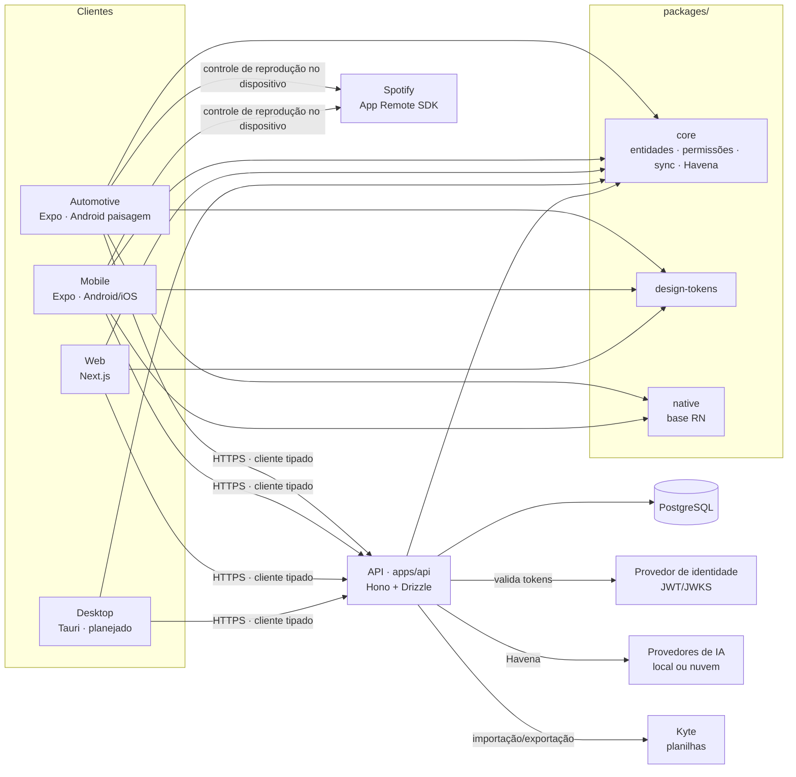
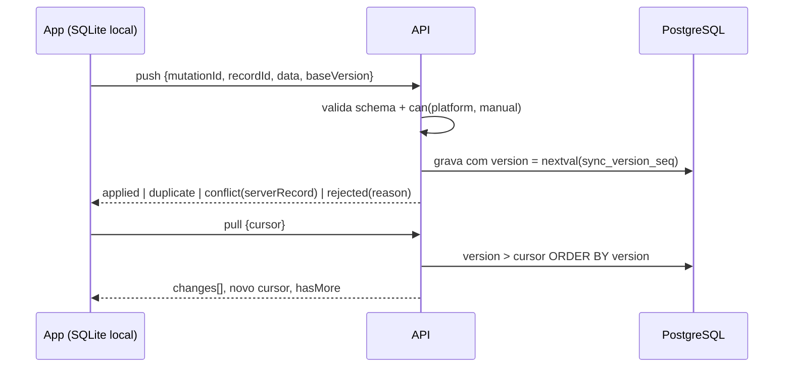
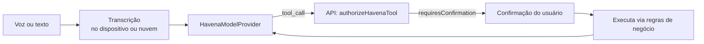

# Arquitetura do GoClient

> Estado: Fase 01 — fundação técnica. Este documento descreve a arquitetura-alvo e marca
> claramente o que **já existe** e o que é **planejado**.

## 1. Visão geral

Princípios:

1. **Uma regra, um lugar.** Regras de negócio estão em `packages/core` e são executadas pela API
   (autoritativa) e pelas interfaces (para não oferecer o que será recusado).
2. **API como única porta de escrita.** Nenhum app acessa o banco diretamente. Isso garante que
   Regras 1–3 valham para todas as plataformas e para a Havena.
3. **Offline-first nos apps de campo** (Automotive e Mobile), com sincronização por versão.
4. **Experiências próprias por plataforma** sobre uma base compartilhada: o Automotive não é o
   Mobile ampliado; ele compartilha regras, dados e componentes base, mas tem telas próprias.

## 2. Plataformas

| App | Pasta | Tecnologia | Alvo | Estado |
|---|---|---|---|---|
| Automotive | `apps/automotive` | Expo SDK 58 · React Native 0.88 · Expo Router | Centrais multimídia Android (APK), 1600×900 paisagem | Fundação + tela de diagnóstico |
| Mobile | `apps/mobile` | Expo SDK 58 · React Native 0.88 · Expo Router | Android e iOS | Fundação + tela de diagnóstico |
| Web | `apps/web` | Next.js 16 (App Router) | Navegadores | Fundação + página de diagnóstico |
| Desktop | — | Tauri 2 (proposto) | Windows/macOS/Linux | Planejado (ADR 0004) |
| API | `apps/api` | Node 22 · Hono · Drizzle · PostgreSQL | Servidor | Funcional (saúde, sessão, sync, Havena) |

Por que Automotive e Mobile são **apps separados** (e não um app com variantes): têm bundles,
navegação, permissões e ciclo de publicação diferentes; o Automotive precisa caber em 4 GB de RAM
sem carregar telas que nunca usará. O que é comum fica em `packages/`. Ver ADR 0002.

### 2.1 Automotive — alvo de hardware

O alvo são **centrais multimídia Android "aftermarket"** (Android comum rodando numa tela de
carro). Elas instalam APKs normais, então React Native funciona.

Não são alvo, por limitação da plataforma e não do GoClient:

- **Android Automotive OS de fábrica** (sistema embarcado de montadoras): apps de terceiros
  ficam restritos a categorias com templates do Google ou a uso com o veículo estacionado.
- **Android Auto** (projeção do celular): só aceita apps em templates (mídia, mensagens,
  navegação, POI). Uma interface React Native não roda lá.

Diretrizes já preparadas na fundação: escala visual própria (`automotiveScale`: alvos de toque
de 76 dp, espaçamento mínimo de 16 dp, corpo de texto 24 pt), paisagem fixa, transições curtas
sem gesto de deslizar para voltar, moldura 1600×900 no Preview.

Orçamento de memória (meta para validar em hardware real na fase de interfaces): app em uso
abaixo de ~250 MB de RAM em dispositivo de 4 GB; listas virtualizadas; imagens redimensionadas
no servidor; nenhum mapa/WebView montado fora de uso.

## 3. Pacotes compartilhados

| Pacote | Responsabilidade | Usado por |
|---|---|---|
| `@goclient/core` | Schemas (zod) das entidades, motor de permissões `can()`, protocolo de sync, contratos da Havena, links de WhatsApp | Todos |
| `@goclient/design-tokens` | Cores, espaçamento, raio, tipografia, movimento; escala Automotive; variáveis CSS | Web, Mobile, Automotive |
| `@goclient/native` | Base React Native: `Text`, `Surface`, `Screen`, `ScaleProvider`, cliente da API com descoberta de host | Mobile, Automotive |
| `@goclient/api/client` | Cliente HTTP **tipado** gerado da definição da API (Hono RPC) | Web, Mobile, Automotive |

Pacotes são publicados como TypeScript-fonte (sem etapa de build): Metro, Next (`transpilePackages`)
e `tsx` compilam diretamente. Menos configuração, e "ir para a definição" leva ao código real.

## 4. Backend

- **Hono** sobre Node 22: leve, tipado e com cliente RPC — se uma rota mudar, os apps quebram
  na checagem de tipos, não em produção.
- **Drizzle ORM** + **PostgreSQL**: schema em TypeScript (`apps/api/src/db/schema.ts`) e
  migrações SQL versionadas em `apps/api/drizzle/`.
- **PGlite** em desenvolvimento e testes: o próprio PostgreSQL compilado para WebAssembly,
  rodando dentro do processo. `pnpm dev:api` funciona sem Docker; os testes usam um banco real em
  memória. Em produção, `DATABASE_URL` aponta para um PostgreSQL gerenciado.

Rotas atuais:

| Rota | Descrição |
|---|---|
| `GET /health` | Estado da API e do banco |
| `GET /v1/me` | Usuário, organização, papel e permissões efetivas **na plataforma da requisição** |
| `POST /v1/sync/pull` | Mudanças desde um cursor |
| `POST /v1/sync/push` | Envio em lote de alterações locais (idempotente) |
| `GET /v1/havena/tools` | Ferramentas da Havena, com decisão de acesso e JSON Schema de entrada |

Toda rota `/v1` exige o cabeçalho `x-goclient-platform` (`automotive`, `mobile`, `web`, `desktop`).

## 5. Banco de dados

Multiempresa desde o início: todo registro de negócio pertence a uma `organization`.

| Tabela | Conteúdo |
|---|---|
| `organizations`, `users`, `memberships` | Contas, usuários e papel de cada usuário na organização |
| `regions`, `customers`, `products` | Dados comerciais (sincronizáveis) |
| `routes`, `visits` | Rotas do dia e visitas (estrutura pronta; módulos em fases futuras) |
| `external_links` | Vínculo de registros com sistemas externos (ex.: ID na Kyte) |
| `sync_mutations` | Mutações já aplicadas, para idempotência |

Colunas comuns às tabelas sincronizáveis: `id` (UUID gerado no cliente, permite criar offline),
`organization_id`, `created_at`, `updated_at`, `deleted_at` (exclusão lógica) e `version`.

## 6. Autenticação

- A API valida tokens **JWT** com o JWKS do provedor de identidade (`GOCLIENT_AUTH_MODE=jwt`) e
  associa o `sub` do token ao usuário (`users.auth_subject`). Qualquer provedor OIDC serve;
  recomendação na ADR 0006.
- Em desenvolvimento (`GOCLIENT_AUTH_MODE=dev`) a API usa um usuário fixo semeado. A API **se
  recusa a iniciar** em produção com esse modo.
- Mesma sessão para todas as plataformas; o app de cada plataforma guarda o token no armazenamento
  seguro do sistema (Keychain/Keystore no nativo, cookie httpOnly na Web) — a implementar na fase
  de autenticação.

## 7. Permissões

`can({ role, platform, channel }, resource, action)` em `packages/core/src/permissions.ts`.

- **Papéis**: `owner`, `admin` (tudo), `seller` (opera clientes, produtos, visitas e rotas; não
  exclui clientes/produtos), `viewer` (somente leitura).
- **Plataforma** e **canal** (`manual`, `havena`, `integration`) entram na decisão:
  - Regra 1 (retirada em 2026-11-24 a pedido do usuário): o Automotive também cadastra e edita
    clientes e produtos à mão.
  - Regra 2: canal `havena` → permitido se o papel permitir, **com confirmação**.
  - Regra 3: `automotive` + escrita em `route` → negado (rotas são montadas no celular), exceto `reorder` (mudar a ordem das paradas, liberado em 2026-11-24).
- `GET /v1/me` devolve a matriz efetiva para a interface decidir o que mostrar.

Limitação honesta: a plataforma é **declarada pelo app**. A Regra 3 é uma regra de produto, não
uma barreira de segurança — quem tem permissão de editar pode editar pelo Mobile. Se for necessário tratá-la como segurança, cada app pode receber credenciais de
cliente próprias (ADR futura).

## 8. Sincronização offline

Protocolo em `packages/core/src/sync.ts`, servidor em `apps/api/src/sync/service.ts`.

- **Relógio lógico**: uma sequência global do PostgreSQL dá a cada escrita uma `version`
  crescente. O cursor do cliente é a maior versão recebida — sem depender de relógios de aparelhos.
- **Exclusões** viajam como registros com `deletedAt` preenchido.
- **Idempotência**: cada mutação tem `mutationId`; reenviar após falha de rede não duplica nada.
- **Conflitos**: se `baseVersion` estiver desatualizado, a mutação volta como `conflict` com o
  registro do servidor. Política inicial: servidor vence e o usuário é avisado.
- **Já implementado**: protocolo, servidor e testes (regiões, clientes e produtos).
- **Próxima fase**: armazenamento local (`expo-sqlite`) e motor de sincronização no cliente
  (`packages/native`), fila de mutações e sincronização em segundo plano. Web começa online.

## 9. Havena

- A Havena **não acessa o banco**: ela chama ferramentas (`havenaTools` em `packages/core`), cada
  uma com nome, descrição, schema de entrada e recurso/ação exigidos.
- Toda chamada passa por `can()` no canal `havena`. Escritas exigem confirmação explícita.
- `HavenaModelProvider` isola o modelo: provedores em nuvem ou modelos locais (no Automotive,
  limitados pela RAM — ver ADR 0007) podem ser trocados sem mexer nas ferramentas.
- `GET /v1/havena/tools` já expõe o catálogo com JSON Schema, formato aceito pelas APIs de
  "function calling" dos provedores de IA.

## 10. Integrações externas

Resumo (detalhes e fontes em `docs/integrations.md`):

| Integração | Situação | Abordagem |
|---|---|---|
| Kyte | Sem API pública documentada | Importação/exportação por planilha (formatos oficiais do Kyte Web); vínculos em `external_links`; contato comercial para API |
| Spotify | Modo de desenvolvimento limitado a 5 usuários; cota estendida exige 250 mil MAU | App Remote SDK no dispositivo (controle do app Spotify instalado); risco de produto registrado |
| WhatsApp | Links `wa.me` | Implementado em `core/whatsapp.ts` |
| Mapas/rotas | A definir | Otimização de sequência no servidor; provedor de distâncias a escolher (ADR futura) |

## 11. Módulos e onde cada um vive

| Módulo | Regras e contratos | API | Interfaces |
|---|---|---|---|
| Clientes | `core/entities` (Customer), permissões, WhatsApp | sync de `customers` | fase futura |
| Produtos | `core/entities` (Product) | sync de `products` | fase futura |
| Rotas | `core/entities` (Route, Visit) | tabelas prontas; otimizador em fase própria | fase futura |
| Música | — | — | Automotive/Mobile, via SDK nativo |
| Havena | `core/havena` | `/v1/havena/tools` | fase futura |
| Configurações | permissões `settings`/`integration` | fase futura | fase futura |

## 12. Ambientes

| Ambiente | Banco | Autenticação | Como |
|---|---|---|---|
| development | PGlite local (`apps/api/.data`) | `dev` | `pnpm dev:*` |
| test | PGlite em memória | `dev` | `pnpm test` |
| production | PostgreSQL gerenciado | `jwt` | variáveis em `apps/api/.env.example` |

Um ambiente **staging** (mesma configuração de produção, banco separado) deve ser criado junto
com o primeiro deploy.
